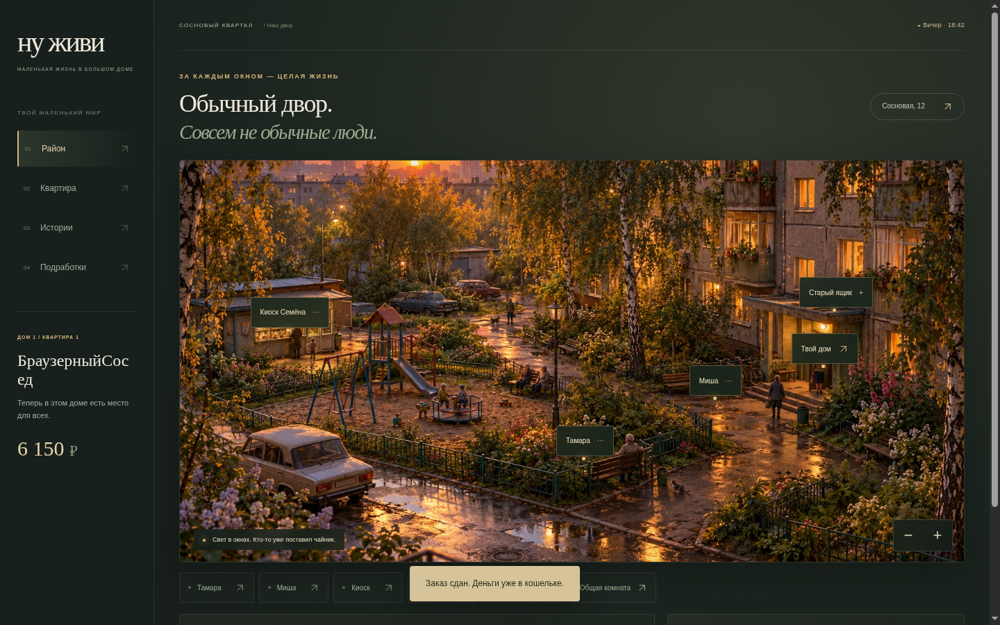

# Ну живи · Последний подъезд

**Играть: https://nu-zhivi.onrender.com**

Версия 0.3 — уютная браузерная narrative/life игра в современном российском дворе. Бесплатный Render + Neon PostgreSQL; первый запуск после простоя может занять около минуты. Это одиночная игра с облачными аккаунтами, не multiplayer.



## Что нового

- Новый фотореалистичный визуал: вечерний двор, квартира, общая комната, портреты Тамары, Миши и Семёна. Шесть сгенерированных для игры ресурсов, около 2.1 MB WebP суммарно, загружаются по мере посещения сцен. Это изображения с интерактивными слоями, не realtime 3D.
- Три законченные главы истории квартиры №0: 20 сюжетных узлов, 18 за одно прохождение из-за двух взаимоисключающих развилок. Письмо Веры, старый альбом, поиск соседей и вечер в общей комнате. Выборы, находки и награды сохраняются на сервере.
- Три подработки: доставка (450 ₽), проверка щитка (600 ₽), заказ в киоске (350 ₽). Сервер генерирует последовательность, проверяет ответ, минимальное время 10 секунд, дедлайн 10 минут и cooldown 90 секунд для каждого типа. Повтор запроса не дублирует оплату.
- Покупка дивана за 2500 ₽ и два сохраняемых положения в квартире. Старые аккаунты, деньги, мебель и первые три сюжетных шага сохраняются.
- Полноэкранные визуальные диалоги, журнал историй и находок, мобильные кнопки локаций, клавиатурная навигация.


## Локальный запуск

Node.js 24+:

```sh
npm ci
npm start
# http://localhost:3000
```

Без DATABASE_URL используется локальная SQLite в data/game.sqlite. Для PostgreSQL передайте DATABASE_URL защищённым окружением. Cookie Secure на HTTPS задаётся COOKIE_SECURE=true; Render origin берётся из RENDER_EXTERNAL_URL. Подробности в [DEPLOY](docs/DEPLOY.md).

```sh
npm run check
npm test
npm run build
node scripts/browser-test.mjs # нужен Chromium, путь переопределяется CHROMIUM
```

Проверены 7 unit/integration сценариев и полный Chromium-проход трёх глав с подработкой. Ширины 1440×900, 390×844, 360×800. Новая таблица job_attempts проверена на отдельной копии Neon-ветки до production. См. [QA](docs/QA.md).

## Технологии и ограничения

Node HTTP, pg Pool / встроенная SQLite, native ES modules, HTML/CSS и WebP. Транзакции, idempotency keys, серверные цены, журнал кошелька, scrypt, HttpOnly/SameSite sessions. Рекомендуемые в исходном ТЗ TypeScript, React, Phaser, Fastify, Prisma, Zod ещё не внедрены. `check` — проверка синтаксиса JS, не TypeScript/ESLint.

Пока отсутствуют multiplayer/WebSocket, чаты, реальные визиты, рынок и бизнесы, свободное перемещение персонажа, realtime 3D, озвучка/музыка, offline play. Настоящие iPhone/Android и нагрузка не тестировались. Время/погода — художественное оформление. PWA manifest и service worker не кэшируют приватные ответы.

[API](docs/API.md) · [Архитектура](docs/ARCHITECTURE.md) · [Безопасность](docs/SECURITY.md) · [Арт](docs/ART_BIBLE.md) · [Экономика](docs/ECONOMY.md) · [План](docs/ROADMAP.md)

Код MIT. Оригинальные сгенерированные ресурсы передаются с проектом; происхождение в [assets-manifest](apps/web/public/assets-manifest.json). Чужие игровые ассеты не использованы.
